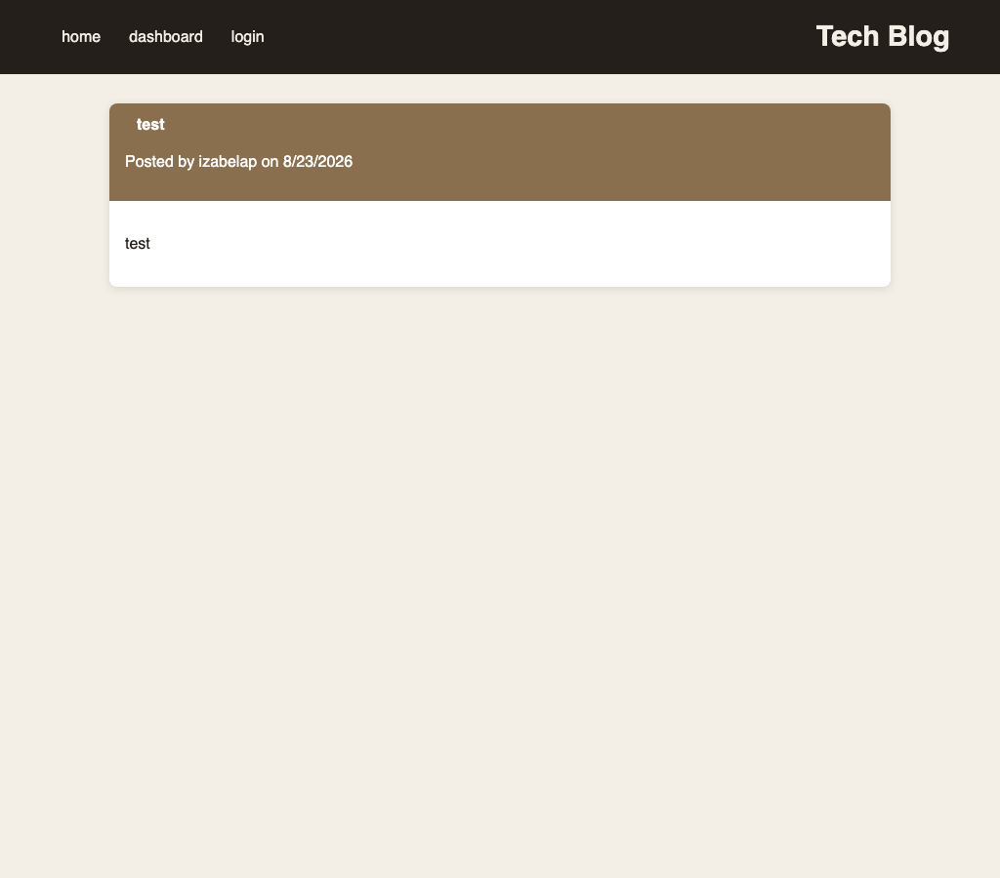

# Tech Blog 

## Description

The Tech Blog is a blog website where developers can publish their blog posts and comment on other developers’ posts as well. This application follows the MVC paradigm and it is using Handlebars.js as the templating language, Sequelize as the ORM, and the express-session npm package for authentication.

## Table of Contents

* [Deployed Application](#deployed-application)
* [User Story](#user-story)
* [Usage](#usage)
* [Installation](#installation)
* [License](#license)
* [Contributing](#contributing)
* [Questions](#questions)


## Deployed Application 

[https://tech-blog-web-production.up.railway.app](https://tech-blog-web-production.up.railway.app)



## User Story 
AS A developer who writes about tech<br />
I WANT a CMS-style blog site<br />
SO THAT I can publish articles, blog posts, and my thoughts and opinions<br />
GIVEN a CMS-style blog site<br />
WHEN I visit the site for the first time<br />
THEN I am presented with the homepage, which includes existing blog posts if any have been posted; navigation links for the homepage and the dashboard; and the option to log in<br />
WHEN I click on the homepage option<br />
THEN I am taken to the homepage<br />
WHEN I click on any other links in the navigation<br />
THEN I am prompted to either sign up or sign in<br />
WHEN I choose to sign up<br />
THEN I am prompted to create a username and password<br />
WHEN I click on the sign-up button<br />
THEN my user credentials are saved and I am logged into the site<br />
WHEN I revisit the site at a later time and choose to sign in<br />
THEN I am prompted to enter my username and password<br />
WHEN I am signed in to the site<br />
THEN I see navigation links for the homepage, the dashboard, and the option to log out<br />
WHEN I click on the homepage option in the navigation<br />
THEN I am taken to the homepage and presented with existing blog posts that include the post title and the date created<br />
WHEN I click on an existing blog post<br />
THEN I am presented with the post title, contents, post creator’s username, and date created for that post and have the option to leave a comment<br />
WHEN I enter a comment and click on the submit button while signed in<br />
THEN the comment is saved and the post is updated to display the comment, the comment creator’s username, and the date created<br />
WHEN I click on the dashboard option in the navigation<br />
THEN I am taken to the dashboard and presented with any blog posts I have already created and the option to add a new blog post<br />
WHEN I click on the button to add a new blog post<br />
THEN I am prompted to enter both a title and contents for my blog post<br />
WHEN I click on the button to create a new blog post<br />
THEN the title and contents of my post are saved and I am taken back to an updated dashboard with my new blog post<br />
WHEN I click on one of my existing posts in the dashboard<br />
THEN I am able to delete or update my post and taken back to an updated dashboard<br />
WHEN I click on the logout option in the navigation<br />
THEN I am signed out of the site<br />
WHEN I am idle on the page for more than a set time<br />
THEN I am automatically signed out of the site<br /> 

## Usage
The Tech Blog is a blog website where developers can publish their blog posts and comment on other developers’ posts as well. 

## Installation

1. Clone the repository and install dependencies:

   ```sh
   git clone https://github.com/izabelacloud/Tech-Blog.git
   cd Tech-Blog
   npm install
   ```

2. Create a `.env` file in the project root with the following variables:

   ```sh
   DB_NAME=tech_blog
   DB_USER=root
   DB_PW=your_mysql_password
   PORT=3001
   SESSION_SECRET=your_session_secret
   ```

   (Alternatively, set `JAWSDB_URL` to a full MySQL connection string, which takes priority over the individual `DB_*` variables.)

3. Seed the database:

   ```sh
   npm run seed
   ```

4. Start the app:

   ```sh
   npm start
   ```

   or, for auto-restart during development:

   ```sh
   npm run watch
   ```

## License

This project is licensed under the MIT.

## Contributing

Izabela Petrovicova


## Questions

If you have any questions about the repository, contact me directly at [i.petrovicova@gmail.com](mailto:i.petrovicova@gmail.com). You can find more of my work at [https://github.com/izabelacloud](https://github.com/izabelacloud).

